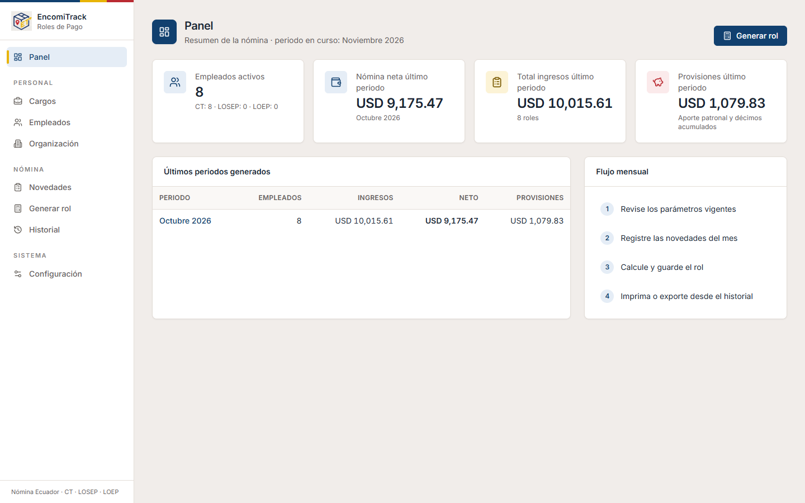
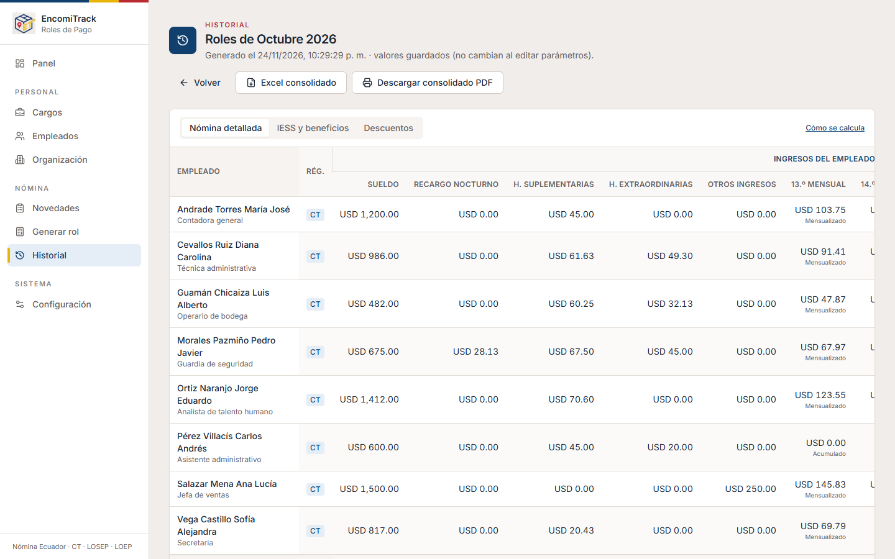
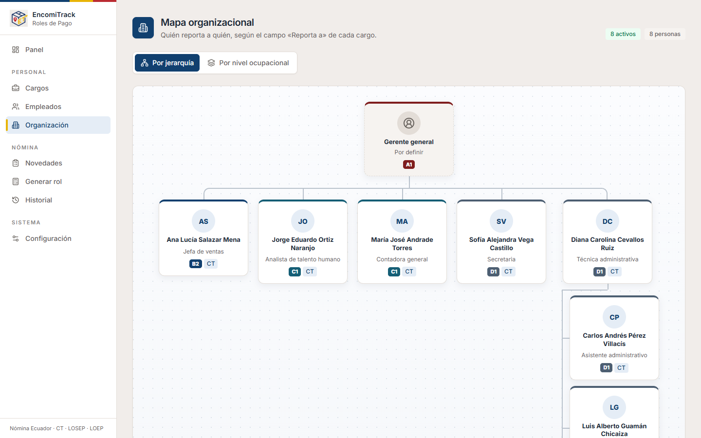
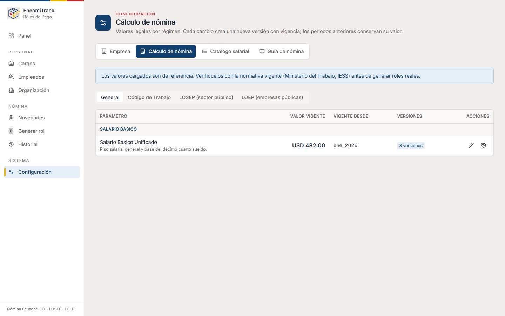
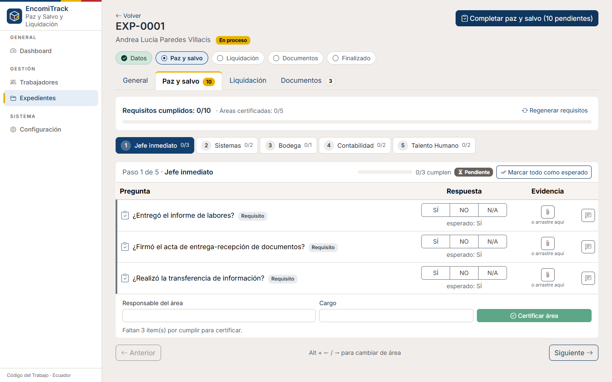
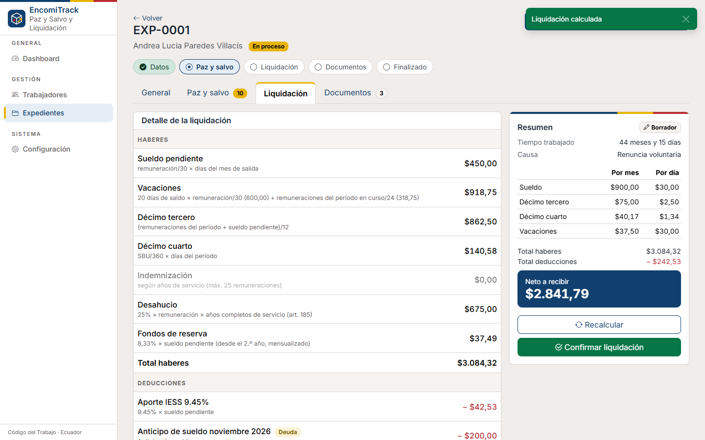
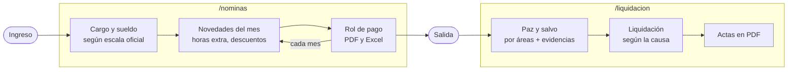
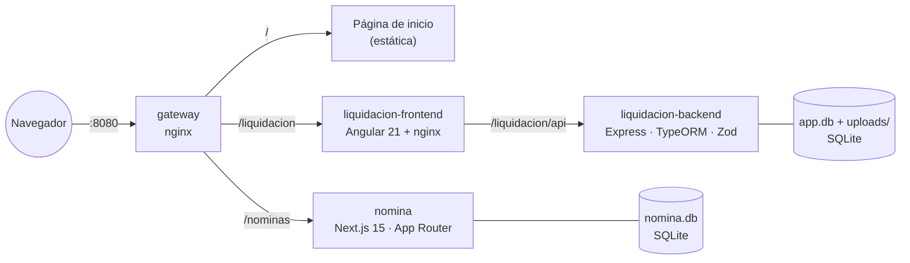

<p align="center">
  
</p>

<h1 align="center">EncomiTrack</h1>

<p align="center">
  Suite de gestión de talento humano para empresas ecuatorianas:<br />
  <b>roles de pago</b> y <b>paz y salvo con liquidación laboral</b>, desplegables con un solo comando.
</p>

<p align="center">
  
  
  
  
  
</p>

---

## ¿Qué resuelve?

Calcular una nómina en Ecuador implica tres regímenes laborales distintos (Código de Trabajo,
LOSEP y LOEP), décimos que pueden pagarse mensualizados o acumulados, fondos de reserva desde el
segundo año y valores legales que cambian cada año. Al terminar la relación laboral, además, hay
que reunir el paz y salvo de varias áreas y calcular la liquidación según la causa de salida.

EncomiTrack cubre ese ciclo con dos módulos:

| Módulo | Ruta | Qué hace |
|---|---|---|
| **Roles de pago** | `/nominas` | Régimen, décimos, horas extra, IESS y fondos de reserva **parametrizados** con vigencia por periodo. Rol individual y consolidado en PDF y Excel. Organigrama por jerarquía y por nivel ocupacional. |
| **Paz y salvo y liquidación** | `/liquidacion` | Expediente de salida con requisitos por área y evidencias, bienes asignados y obligaciones pendientes. Cálculo de la liquidación por causa (renuncia, desahucio, despido intempestivo…) y actas en PDF. |

> Los datos que se cargan al iniciar (empresa, empleados, casos) son **ficticios** y sirven solo para demostración.

## Capturas

| Panel de nómina | Rol de pago detallado |
|---|---|
|  |  |
| **Organigrama por jerarquía** | **Parámetros legales con vigencia** |
|  |  |
| **Paz y salvo por áreas** | **Liquidación calculada** |
|  |  |

<sub>Las capturas se regeneran con `docs/capturar.mjs` (ver [docs/README.md](docs/README.md)).</sub>

## Ciclo del empleado



## Arquitectura



- **Un solo puerto publicado.** El gateway es el único servicio expuesto (solo en `127.0.0.1`).
  Cada aplicación atiende sus rutas con prefijo, así el mismo despliegue funciona detrás de
  Traefik/Dokploy sin “strip path”.
- **Dinero sin punto flotante.** Nómina calcula en centavos enteros con `bigint`; liquidación usa
  `decimal.js` con redondeo *half-up*.
- **Parámetros con vigencia.** Cambiar un porcentaje crea una versión nueva desde un periodo; los
  roles anteriores se reimprimen con los valores que tenían cuando se calcularon.
- **Bases independientes.** Hoy cada módulo tiene su propia base SQLite. Compartir el maestro de
  empleados entre ambos está en el [trabajo futuro](#trabajo-futuro).

## Inicio rápido

Requisito: Docker Desktop (o Docker Engine con Compose v2).

```bash
git clone https://github.com/Jostero32/EncomiTrack.git
cd EncomiTrack
docker compose up -d --build
```

Abrir <http://localhost:8080>. La primera vez la base de nómina se llena con datos de ejemplo.

| Variable | Por defecto | Uso |
|---|---|---|
| `PORT` | `8080` | Puerto del gateway en el equipo |
| `CARGAR_DATOS_EJEMPLO` | `1` | `0` para iniciar la nómina vacía |
| `TZ` | `America/Guayaquil` | Zona horaria para periodos y fechas |

Para borrar todo y empezar de cero: `docker compose down -v`.

## Estructura

```
EncomiTrack/
├── apps/
│   ├── nomina/          Roles de pago (Next.js + better-sqlite3) · ver su README
│   └── liquidacion/     Paz y salvo y liquidación (Angular + Express) · ver su README
├── gateway/
│   ├── nginx.conf       Enrutamiento por subruta
│   └── html/            Página de inicio de la suite
├── docs/                Capturas y documentación general
└── docker-compose.yml   Suite completa
```

Cada aplicación puede desarrollarse y desplegarse por separado; los detalles están en
[`apps/nomina/README.md`](apps/nomina/README.md) y [`apps/liquidacion/README.md`](apps/liquidacion/README.md).

## Pruebas

```bash
cd apps/nomina && npm install && npm test                 # motor de cálculo de nómina (vitest)
cd apps/liquidacion/backend && npm install && npm test    # cálculos de liquidación (vitest)
```

## Trabajo futuro

- Maestro de empleados compartido: que la liquidación tome cargo, sueldo e historial desde nómina.
- Autenticación y roles de usuario comunes para la suite.
- Impuesto a la renta proyectado, utilidades y vacaciones en nómina.

## Historial

Este repositorio une dos proyectos que antes vivían por separado. La historia de
`sistema-paz-y-salvo` se conservó con `git subtree` dentro de `apps/liquidacion/`.
