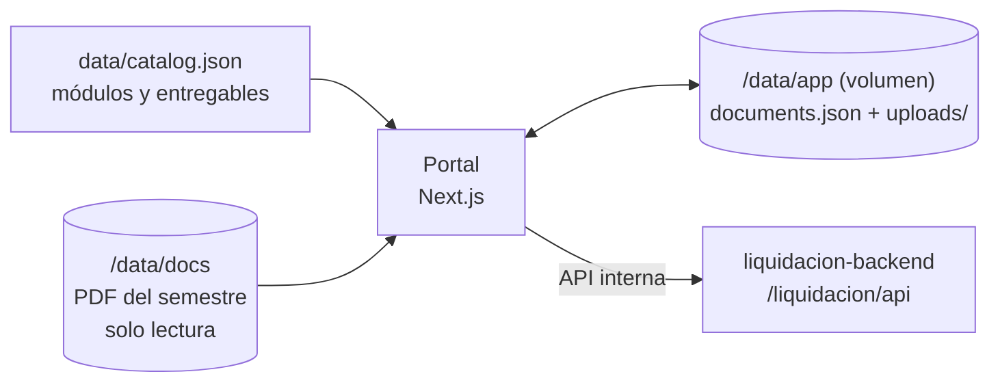

# Portal académico · Emprendimiento y Legislación Laboral

Portal integrador de la asignatura **Emprendimiento y Legislación Laboral** (octavo semestre · FISEI ·
Universidad Técnica de Ambato). Reúne los entregables del semestre alrededor del emprendimiento
**EncomiTrack** y enlaza los dos sistemas construidos en la materia: roles de pago y paz y salvo con liquidación.

**Stack:** Next.js 15 (App Router, salida *standalone*) · TypeScript · Tailwind CSS · react-pdf · Docker.

## Módulos

| # | Módulo | Contenido |
|---|---|---|
| 1 | Emprendimiento | Idea de negocio, Canvas, perfil estratégico, mercado, estudio económico, registro de marca |
| 2 | Obligaciones tributarias | RUC simulado, facturación electrónica, declaración del IVA, importación |
| 3 | Remuneraciones | Enlace y vista embebida del sistema de **roles de pago** (`/nominas`) |
| 4 | Liquidación | Sistema de **paz y salvo y liquidación** (`/liquidacion`) con panel de datos en vivo |

## Cómo guarda los datos



- **Catálogo fijo**: `data/catalog.json` describe los entregables con resumen y cifras clave. Si el PDF
  no está en `DOCS_ROOT`, el portal muestra igual la ficha del documento, sin el archivo.
- **Documentos subidos**: con `ADMIN_PASSCODE` y `SESSION_SECRET` aparece *Gestionar documentos*. Los
  archivos van a `DATA_DIR/uploads/` y su ficha a `DATA_DIR/documents.json` (escritura atómica). En Docker,
  `DATA_DIR` es un volumen.
- **Sin servicios externos**: la primera versión usaba Supabase (PostgreSQL + Storage); se reemplazó por el
  volumen para que toda la suite se levante con `docker compose`.

## Desarrollo

```bash
cp .env.example .env      # opcional: clave de administración
npm install
npm run dev               # http://localhost:3000/emprendimiento-dashboard
```

Para ver el panel de liquidación en vivo, levante la suite completa desde la raíz del repositorio.

## Docker

Se construye y despliega como parte de la suite (ver el [README principal](../../README.md)). La imagen se
publica bajo `/emprendimiento-dashboard` (build arg `BASE_PATH`; `""` = raíz), corre como usuario sin
privilegios con sistema de archivos de solo lectura y escribe únicamente en `/data/app`.

## Scripts

- `scripts/remaster_logos.py`: limpieza y vectorización de los logos UTA/FISEI (Pillow + OpenCV + potrace).
