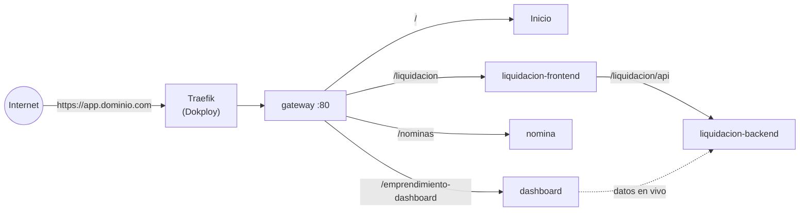

# Despliegue en Dokploy (una sola aplicación)

Toda la suite se despliega como **una aplicación de tipo Compose**. Traefik (el proxy de Dokploy) envía
el dominio al servicio `gateway`, y el gateway reparte por subruta:



## Pasos

1. **Create Service → Compose**, proveedor GitHub, repositorio `EncomiTrack`, rama `main`.
2. **Compose Path:** `./docker-compose.yml`. Dokploy usa solo ese archivo; el
   `docker-compose.override.yml` (puerto local) no se aplica en el servidor.
3. **Environment:**
   ```env
   ADMIN_PASSCODE=una-clave-segura
   SESSION_SECRET=resultado-de-openssl-rand-hex-32
   COOKIE_SECURE=true
   DOCS_DIR=/ruta/en/el/servidor/con/los/pdf
   ```
4. **Domains:** agregar el dominio, servicio **`gateway`**, puerto **`80`**, path `/`, HTTPS con Let's Encrypt.
   No hace falta un dominio por aplicación: las subrutas las resuelve el gateway.
5. **Deploy.**

## Material del semestre (PDF)

Los PDF del catálogo no se versionan. Cópielos al servidor en la carpeta indicada en `DOCS_DIR`, con la
estructura `Primer_Parcial/` y `Seundo_Parcial/`. Sin ellos el portal funciona y muestra la ficha de cada
entregable sin el archivo. Los documentos que se suban desde *Gestionar documentos* quedan en el volumen
`dashboard_data` y sobreviven a los redespliegues.

## Datos persistentes

| Volumen | Contenido |
|---|---|
| `dashboard_data` | `documents.json` y archivos subidos al portal |
| `nomina_data` | `nomina.db` (SQLite) |
| `liquidacion_data` | `app.db` (SQLite) y evidencias subidas |

## Migración desde el despliegue anterior

Antes cada aplicación era un servicio separado de Dokploy con su propio *path* en el mismo dominio
(`/nominas`, `/liquidacion`, `/liquidacion/api`, `/emprendimiento-dashboard`). Las subrutas se mantienen,
así que los enlaces existentes siguen funcionando. Para conservar datos, copie `nomina.db` y `app.db` de los
volúmenes anteriores a los nuevos antes de borrar los servicios viejos.
